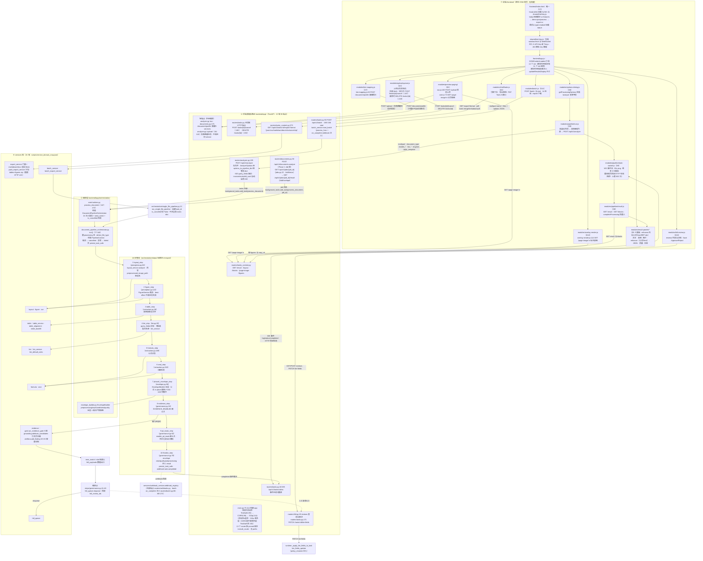
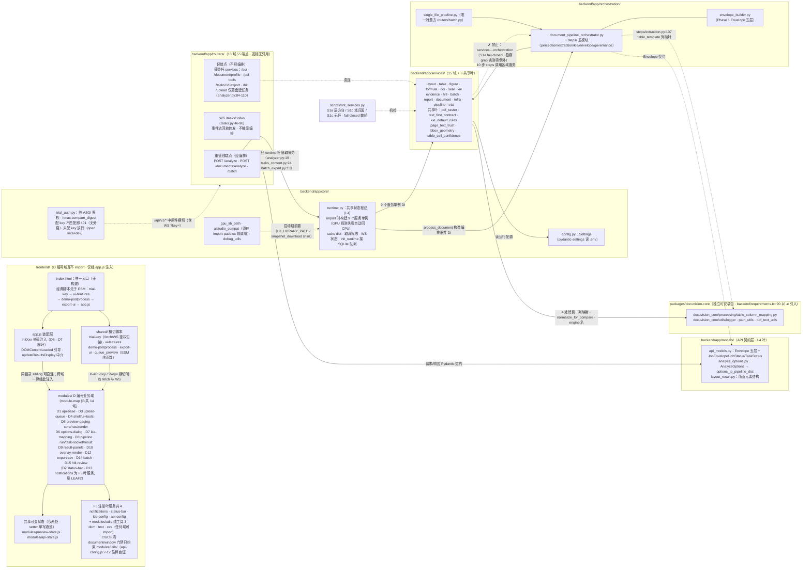
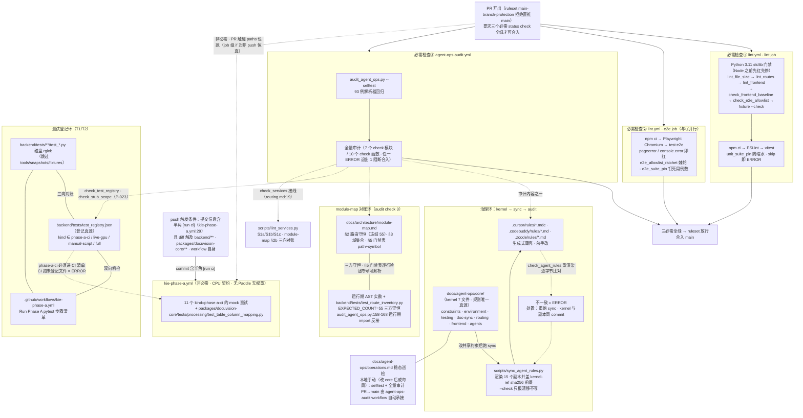

# DocuVision 整仓逻辑处理图（logic-flow）

> 依据 2026-11-05 的三份只读勘察绘制：backend/ 与 packages/ 处理逻辑、frontend、运维与治理管线。
> 分区口径与 `docs/architecture/module-map.md` 一致（13 个路由域 55 端点、services 15 域 + 6 共享叶、前端 D 编号域）。
> 本文件与 `docs/architecture/logic-flow.html`（Mermaid CDN 渲染版）内容一致；节点内 `文件:行号` 为源码锚点。

## 图① 端到端业务数据流（前端入口 → 后端路由 → services 域 → 证据/导出）

说明：

1. 前端唯一入口 `frontend/index.html` 以 defer/module 顺序先加载 `frontend/shared/trial-key.js` 的 fetch/WebSocket 鉴权包装，再加载 `frontend/app.js`；Run Analysis 主链自 `frontend/modules/pipeline/run.js`（D6 组表单 → 表格映射门禁）POST `/api/v1/analyze`（`backend/app/routers/analyzer.py:139`），事件经 `backend/app/routers/tasks.py:46` 的 WebSocket 回流，重连耗尽回退每秒 HTTP 轮询（上限 600 次）。预览侧：`/upload`（预览上传）由 D5 `preview-paging/nav.js:160` 调用、`/document/profile`（画像预扫）由 D7 `kie-mapping.js:63` 调用，`/page-image` 由 D5 `preview-paging/core.js:73` 与 D10 `overlay-render.js:114` 调用；`upload-queue.js` 自身仅调 `POST /tasks/{id}/cancel`（:187）与 `DELETE /tasks/{id}`（:249）。
2. 后端把任务注册进 `backend/app/core/runtime.py` 的 tasks dict，经 `background_tasks.add_task(process_document)` 进入 `process_document`（runtime.py:447-472），由 DocumentPipelineOrchestrator.run（`backend/app/orchestration/document_pipeline_orchestrator.py:77-144`）按 112-123 行定义的固定顺序执行 steps/ 的 10 个 step（该顺序本次会话已抽查核对，与图一致）。
3. 10 步管线依次覆盖感知（layout/figure）、抽取（table/kie/formula/seal）、封套（phase1_envelope，五层 Envelope 由 `backend/app/orchestration/envelope_builder.py` 构建）与治理（evidence/pii/finalize）；证据链路受 `EVIDENCE_ENABLED` 闸控制（默认关），near_match/slot 结果以 hitl_payloads 数据出口，在编排点（steps/governance.py:41-48）入队 hitl_queue，人工复核经 `/api/v1/hitl/reviews` 与 `PATCH /tasks/:id/kie-fields` 回写。
4. 导出与批量为两条旁链：`GET /api/v1/tasks/:id/export/:format` 直入 export_service 门面（zip 由 pack_export_service 打包、超限 HTTP 413）；批量经 `batch_service.start_batch` → `run_single_file_pipeline`（`backend/app/orchestration/single_file_pipeline.py:13`）汇入同一编排器。另有 Phase 1 Job 版入口 `POST /api/v1/documents:analyze`（`backend/app/routers/documents.py:30`），经 `background_tasks.add_task(process_document, job_id)`（`documents.py:164`）汇入同一编排，查询端点为 `GET /api/v1/jobs/{job_id}`（`backend/app/routers/jobs.py:22` · JobStatus）与 `GET /api/v1/jobs/{job_id}/result`（JobEnvelope）——无 `/status` 后缀端点。

## 图② 模块/服务依赖关系（含 core / models / packages 边界）

说明：

1. 后端依赖三铁律：13 个 router 互不引用、统一经 `backend/app/core/runtime.py` 枢纽取服务（runtime 在 import 时构建 9 个服务单例，GPU 探测失败自动回 CPU）；编排层经 DI 消费 services；services→orchestration 是 S1a 禁止边（`scripts/lint_services.py` fail-closed 机检，本次勘察 grep 实测 backend/app/services/** 无任何 from/import app.orchestration）。
2. 轻端点不经编排：/ocr、/document/profile、/pdf-tools、/tasks/:id/export、/hitl 直接薄委托 services，/upload（analyzer.py:84-110）仅落盘建任务、不调 service；重管线端点（/analyze、/documents:analyze、/batch）进 orchestration；WS /tasks/:id/ws 只从 runtime 事件历史回放转发（tasks.py:46-90，含 since/last_event_id），不触发编排。
3. 支撑层：core/ 内 config.py（pydantic-settings 读 .env）、trial_auth.py（纯 ASGI 鉴权：配 key 不匹配即 401，未配 key 放行 open local-dev）、gpu_lib_path/aistudio_compat/debug_utils（启动期前置）；`backend/app/models/` 是 API 契约层（Envelope 五层、AnalyzeOptions→管线 dict、版面元素结构）；`packages/docuvision-core` 以可安装包形式（backend/requirements.txt:90 以 -e 引入）被 4 处消费：`backend/app/orchestration/steps/extraction.py:107`（table_template 列映射）、`backend/app/services/table_alignment.py:22` 与 `table_backfill.py:13`（normalize_for_compare）、`backend/app/services/document_profile.py:21`（engine 名）。
4. 前端侧：D 编号域互不 import，跨域只经 `frontend/app.js` 模块作用域注入（同目录 sibling 允许直连，如 pipeline/run→result→task-socket）；共享可变状态仅 `frontend/modules/preview-state.js` 与 `frontend/modules/api-state.js` 两处（setter 单写通道）；`frontend/shared/trial-key.js` 以包装 window.fetch/WebSocket 实现鉴权横切；`window.DOCUVISION_CONFIG` 仓库内无定义处，属部署期外部注入。

## 图③ 运维与治理管线（PR → CI 门禁序列 + kernel → sync → audit 治理环）

说明：

1. 合入闸（书面口径见 `docs/agent-ops/operations.md:143-145` 与 lint.yml 注释）：ruleset main-branch-protection 要求 lint、e2e、agent-ops-audit 三个必需检查全绿，直推 main 被拒；lint job 先跑 Python stdlib 门禁再进 Node（npm ci → ESLint → vitest），e2e job 并行跑 Playwright（pageerror/console.error 即红）。
2. agent-ops-audit 先跑 93 例 `--selftest` 再全量审计（7 个 check 模块 / 10 个 check 函数，任一 ERROR 退出 1）；kie-phase-a 为非必需的 CPU 契约测试（无 Paddle、无权重）：push 需提交信息含半角 `[run ci]`（kie-phase-a.yml:29）且 diff 触及 backend/**、packages/docuvision-core/** 或 workflow 自身；PR 触碰相同 paths 也运行（job 级 `if: github.event_name != 'push' || contains(...)` 对非 push 事件恒真）；跑的正是 test_registry.json 中 kind=phase-a-ci 的 11 个文件加 packages 测试。
3. 治理环闭环：改 `docs/agent-ops/core/` kernel → 跑 `scripts/sync_agent_rules.py` 派生 15 个副本（.cursor/.codebuddy/.zcode，盖 kernel-ref sha256 前缀）→ CI 中 check_agent_rules 重渲染逐字节比对，不一致即 ERROR，处置动作是重跑 sync 且 kernel 与副本同 commit。
4. 两条数据对账环：module-map §2 路由守恒（冻结 55）↔ AST 实数 ↔ `backend/tests/test_route_inventory.py` 的 EXPECTED_COUNT 三方守恒；`backend/tests/test_registry.json` ↔ 磁盘 ↔ kie-phase-a.yml 清单三向对账（phase-a-ci 双向机检）。注意 pytest 运行时不消费 registry——它只服务于审计期防 dangling test。
5. 已知文档矛盾（图按 kernel/operations 口径绘制）：lint.yml:115-116 的 e2e 注释仍称 branch protection 未启用，与 required checks 口径相抵。（原记载的「根 AGENTS.md 称 ZCode 已退役」矛盾已于 2026-11-06 修正对齐 kernel。）

## 未决事项（勘察遗留，图未下结论）

- 版本口径未定论：module-map.md 头部“最近对照 v1.13.0（main 07de132）”、`backend/app/core/config.py:22` APP_VERSION="1.9.0"、CHANGELOG.md 首节 [Unreleased]，三者来源不一致；本图不标注版本号。
- GitHub ruleset（main-branch-protection 的 required checks 配置）本会话无法核验（gh 未认证），图③合入闸依据 lint.yml 注释与 operations.md 书面口径。
- GPU 相关能力（模型服务实际行为）未验证：本机无 GPU（仓库红线），图中 GPU 探测/回退仅按代码静态描述。
